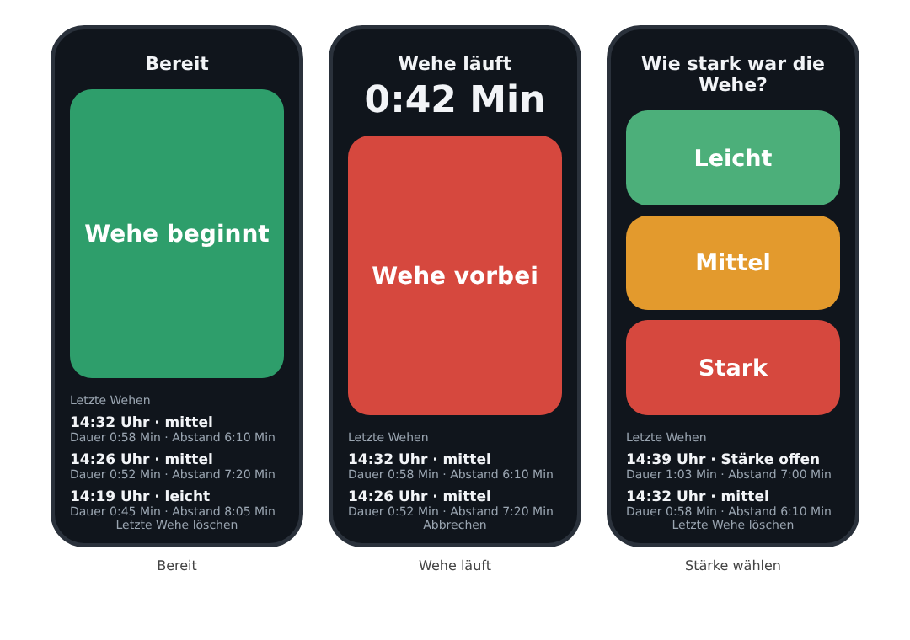

# Wehentracker

Eine winzige Android-App zum Mitschreiben von Wehen. Ein großer Button, sonst nichts.



*Schematische Darstellung mit Beispielwerten.*

## Bedienung

1. **„Wehe beginnt“** tippen, wenn die Wehe anfängt. Ein Timer läuft mit.
2. **„Wehe vorbei“** tippen, wenn sie vorbei ist.
3. Stärke wählen: **Leicht**, **Mittel** oder **Stark**.

Unter dem Button stehen die letzten drei Wehen mit Uhrzeit, Stärke, Dauer und Abstand zur vorherigen Wehe.
Mit dem kleinen Knopf unten lässt sich die letzte Wehe löschen (oder eine laufende verwerfen).

Die App läuft komplett offline. Alle Daten bleiben auf dem Handy, es gibt keine Berechtigungen, keinen Server und keine Werbung.
Das Display bleibt an, solange die App offen ist.

## Installieren (Android 6 oder neuer)

1. Die Datei [**Wehentracker.apk**](https://github.com/alexanderclemen/wehentracker/raw/main/apk/Wehentracker.apk) herunterladen (Link direkt auf dem Handy antippen).
2. Datei auf dem Handy öffnen. Beim ersten Mal fragt Android, ob der Browser oder Dateimanager Apps installieren darf. Das einmalig erlauben.
3. Installieren und die App „Wehentracker“ öffnen.

Hinweis: Die App ist nicht im Play Store. Android zeigt deshalb beim Installieren eine Warnung zu unbekannten Quellen.

## Selbst bauen

Gebaut wird ohne Gradle, nur mit den Android-Kommandozeilentools. Unter Ubuntu/Debian:

```bash
sudo apt install aapt apksigner zipalign android-sdk-platform-23 dalvik-exchange default-jdk
./tools/build.sh
```

Das Ergebnis liegt in `build/wehentracker.apk`. Beim ersten Lauf wird ein eigener Signierschlüssel `release.keystore` erzeugt.
Eine selbst gebaute APK hat deshalb eine andere Signatur als die fertige in `apk/`. Beide lassen sich nicht übereinander installieren, die ältere muss vorher deinstalliert werden.
Wer die App selbst weitergibt oder später aktualisieren will, muss denselben Schlüssel behalten, sonst lässt sich ein Update nicht über die alte Version installieren.

## Aufbau

- `src/home/wehentracker/MainActivity.java`: die gesamte App
- `AndroidManifest.xml`, `res/`: Manifest und Icon
- `tools/build.sh`: Build-Skript
- `apk/Wehentracker.apk`: fertig gebaute Version 1.0

## Lizenz

MIT, siehe `LICENSE`.
